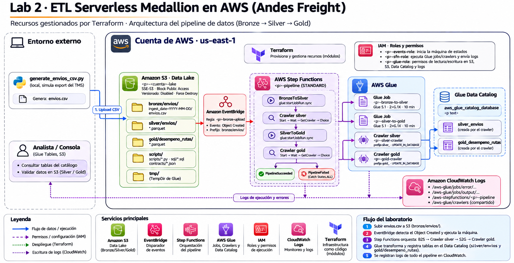

# Lab 2 — ETL serverless en AWS con arquitectura medallion

Laboratorio del bootcamp AWS Data Engineer. Un operador de carga ficticio
(**Andes Freight**) recibe cada día un CSV de envíos. El pipeline lo lleva por
las capas **bronze → silver → gold** con AWS Glue, lo registra en el Glue Data
Catalog y se dispara solo al subir el archivo (EventBridge + Step Functions).

```
CSV ─► S3 bronze/ ─► EventBridge ─► Step Functions
                                      ├─ Glue job bronze_to_silver ─► silver/ ─► crawler ─► silver_envios
                                      └─ Glue job silver_to_gold   ─► gold/   ─► crawler ─► gold_desempeno_rutas
```

## Índice

### Documentación (léela en este orden)

| # | Documento | Qué responde | Lectura |
|---|---|---|---|
| 1 | [Caso de negocio](docs/01-caso-de-negocio.md) | ¿Qué problema tiene la empresa? ¿Qué datos llegan y qué KPIs necesita? | 10 min |
| 2 | [Arquitectura](docs/02-arquitectura.md) | ¿Qué se construye en AWS, por qué así y cuánto cuesta? | 10 min |
| 3 | [Implementación técnica](docs/03-implementacion.md) | ¿Cómo está hecho? Terraform, Glue, SQL, tests y hallazgos del despliegue | Referencia |
| 4 | [Validación con Athena](docs/04-validacion-athena.md) | ¿Cómo compruebo que gold tiene datos correctos? 4 consultas de KPIs | 15 min (práctica) |
| 5 | [Cambio en vivo](docs/05-cambio-en-vivo.md) | ¿Cómo se pide a un agente de IA un cambio de esquema acotado? | 10 min |

### Guía práctica (en este README)

1. [Requisitos](#requisitos)
2. [Preparar el entorno](#1-preparar-el-entorno)
3. [Desplegar la infraestructura](#2-desplegar-la-infraestructura)
4. [Probar la solución de punta a punta (E2E)](#3-probar-la-solución-de-punta-a-punta-e2e):
   criterios de éxito, carga de datos, consola, Athena y tests post-despliegue
5. [Tests](#4-tests)
6. [Diagrama de arquitectura](#5-diagrama-de-arquitectura)
7. [Cambio en vivo](#6-cambio-en-vivo)
8. [Limpieza](#7-limpieza)
9. [Estructura del repositorio](#estructura-del-repositorio)
10. [Problemas conocidos](#problemas-conocidos)

### Referencia

| Recurso | Contenido |
|---|---|
| [docs/ppt/Bootcamp-AWS-Sesion-2.pdf](docs/ppt/Bootcamp-AWS-Sesion-2.pdf) | Presentación de la sesión 2 del bootcamp |
| [docs/architecture/](docs/architecture/) | Diagrama de todos los recursos AWS gestionados por Terraform: fuente [architecture.dot](docs/architecture/architecture.dot) (Graphviz) e imagen [arch2.png](docs/architecture/arch2.png) |
| [docs/adr/](docs/adr/) | Decisiones de arquitectura: [0001 medallion](docs/adr/0001-etl-medallion-glue-s3.md), [0002 crawlers](docs/adr/0002-data-catalog-con-crawlers.md), [0003 orquestación](docs/adr/0003-orquestacion-eventbridge-step-functions.md) |
| [AGENTS.md](AGENTS.md) | Reglas para agentes de IA (Claude, Codex) en este repo |

## Requisitos

* Cuenta de AWS con permisos para S3, Glue, IAM, Step Functions, EventBridge,
  CloudWatch Logs y Athena (región por defecto `us-east-1`).
* [uv](https://docs.astral.sh/uv/) (gestiona Python 3.12 y las dependencias).
* Terraform ≥ 1.6.
* AWS CLI (opcional, para comandos de inspección).
* Graphviz (opcional, para ver el diagrama).
* Terminal: Git Bash en Windows, o cualquier shell POSIX.

## 1. Preparar el entorno

```bash
uv sync                                    # crea .venv con Python 3.12 y dependencias
cp .env.example .env.credentials           # completar con tus credenciales (no se versiona)
cp infra/terraform.tfvars.example infra/terraform.tfvars   # ajustar si hace falta
```

Los scripts de Python leen `.env.credentials` solos. **Terraform y la AWS CLI
no lo leen**: hay que exportar las variables en la terminal (o usar un perfil
de `~/.aws`):

```bash
set -a; source .env.credentials; set +a
```

Comprobar el entorno local (no toca AWS):

```bash
uv run python scripts/testing/run_pytest.py      # tests locales
```

## 2. Desplegar la infraestructura

```bash
terraform -chdir=infra init
terraform -chdir=infra plan      # revisar qué se crea
terraform -chdir=infra apply     # crea bucket, Glue, Step Functions, EventBridge, IAM, logs
```

Guardar el nombre del bucket para los scripts:

```bash
export LAB_BUCKET=$(terraform -chdir=infra output -raw lake_bucket_name)
```

## 3. Probar la solución de punta a punta (E2E)

La prueba E2E recorre todo lo que hace la solución en AWS: **un CSV llega a
bronze → EventBridge dispara Step Functions → los jobs de Glue generan silver y
gold → los crawlers actualizan el catálogo → los KPIs se consultan en Athena**.

### Criterios de éxito

La solución funciona si se cumplen los 6 puntos. Los pasos de abajo indican
cómo comprobar cada uno.

| # | Qué debe pasar | Cómo se comprueba | Paso |
|---|---|---|---|
| 1 | Subir el CSV a `bronze/envios/` arranca el pipeline solo | Aparece una ejecución nueva en Step Functions | 3.1 |
| 2 | La ejecución termina en `PipelineSucceeded` | `check_pipeline.py` muestra `SUCCEEDED` | 3.1 |
| 3 | Hay Parquet en `silver/envios/` y `gold/desempeno_rutas/` | `check_pipeline.py` / consola de S3 | 3.1, 3.2 |
| 4 | Las tablas del catálogo coinciden con los contratos | `check_pipeline.py` / tests post-despliegue | 3.1, 3.4 |
| 5 | Los KPIs de gold son coherentes (OTD entre 0 y 100, 10 rutas) | Consultas de Athena | 3.3 |
| 6 | La infraestructura cumple los guardrails (bucket privado, log groups con retención, regla filtrada por `bronze/envios/`) | Tests post-despliegue | 3.4 |

Requisito previo: haber completado [1. Preparar el entorno](#1-preparar-el-entorno)
y [2. Desplegar la infraestructura](#2-desplegar-la-infraestructura), con
`LAB_BUCKET` exportado.

### 3.1 Cargar datos y seguir la ejecución

`scripts/check_pipeline.py` sube el CSV con boto3, espera a que EventBridge
arranque Step Functions, muestra cada paso y al final verifica S3, el catálogo
y gold. Cubre los criterios 1 a 4 de una vez.

```bash
# Generar el lote de un día (queda en data/envios_<fecha>.csv)
uv run python scripts/generate_envios_csv.py --date 2026-11-13

# Subirlo y probar todo el pipeline (~8–13 min)
uv run python scripts/check_pipeline.py --file data/envios_2026-11-13.csv
```

Salida real de esa prueba:

```
Pipeline lab2-etl-dev | bucket lab2-etl-dev-<cuenta>-lake | base lab2_etl_dev

1. Ejecución
  1030 filas de envios_2026-11-13.csv -> s3://<bucket>/bronze/envios/ingest_date=2026-11-13/envios.csv
  EventBridge arrancó la ejecución

2. Seguimiento
  [00:00] BronzeToSilver
  [02:17] WaitSilverCrawler
  [02:48] SilverToGold
  [04:52] WaitGoldCrawler
  [07:59] PipelineSucceeded
  [OK]    SUCCEEDED en 0:07:51

3. Resultados
  [OK]    s3://<bucket>/silver/envios/: 1 archivo(s) Parquet
  [OK]    s3://<bucket>/gold/desempeno_rutas/: 1 archivo(s) Parquet
  [OK]    lab2_etl_dev.silver_envios: 11 columnas iguales al contrato
  [OK]    lab2_etl_dev.gold_desempeno_rutas: 11 columnas iguales al contrato
  [OK]    gold: 150 filas, OTD entre 60.0% y 100.0%

Pipeline OK
```

El script termina con código `0` si todo está bien. Con `1`, muestra el error
de la ejecución o qué columna difiere del contrato.

| Comando | Para qué |
|---|---|
| `uv run python scripts/check_pipeline.py --file data/envios_<fecha>.csv` | Subir un CSV existente tal cual (la fecha de ingesta se toma del nombre) |
| `uv run python scripts/check_pipeline.py --upload` | Generar el lote de hoy, subirlo y probar todo |
| `uv run python scripts/check_pipeline.py --start` | Reprocesar lo que ya está en bronze, sin subir datos |
| `uv run python scripts/check_pipeline.py` | Solo verificar la última ejecución |
| `... --prefix lab2-etl-prod --bucket <b>` | Otro entorno o bucket |

> Es `uv run python ...`. `uv scripts/...` sin `run` falla con
> `unrecognized subcommand`.

### 3.2 Verificar en la consola de AWS

Mientras corre la ejecución, o después:

* **Step Functions → `lab2-etl-dev-pipeline` → última ejecución:** el grafo
  muestra cada paso en verde. La primera ejecución del día es la más lenta
  (~13 min) por el arranque en frío de Glue.
* **S3 → bucket `lab2-etl-dev-<cuenta>-lake`:** el CSV en `bronze/envios/` y los
  Parquet en `silver/envios/` y `gold/desempeno_rutas/`.
* **Glue → Data Catalog → Databases → `lab2_etl_dev`:** las tablas
  `silver_envios` y `gold_desempeno_rutas`. La pestaña de versiones de cada
  tabla muestra el historial de esquemas.
* **CloudWatch → Log groups:** `/aws-glue/lab2-etl-dev/output` (salida de los
  jobs) y `/aws/vendedlogs/states/lab2-etl-dev-pipeline` (Step Functions). Los
  crawlers escriben en `/aws-glue/crawlers`, en un log stream con el nombre de
  cada crawler.

### 3.3 Validar los KPIs de gold en Athena

Las consultas sugeridas están en
[docs/04-validacion-athena.md](docs/04-validacion-athena.md): una por cada
pregunta del caso de negocio (puntualidad, tránsito, volumen e ingreso), con
qué resultado esperar en cada una.

1. Configurar una sola vez la ubicación de resultados: **Athena → Query editor →
   Settings → Manage** → `s3://lab2-etl-dev-<cuenta>-lake/athena-results/`.
2. Elegir la base `lab2_etl_dev`.
3. Ejecutar las 4 consultas. Una comprobación rápida, para empezar:

   ```sql
   SELECT origen, destino,
          ROUND(100.0 * SUM(envios_a_tiempo) / NULLIF(SUM(envios_entregados), 0), 2) AS otd_pct
   FROM lab2_etl_dev.gold_desempeno_rutas
   GROUP BY origen, destino
   ORDER BY otd_pct;
   ```

   Esperado: 10 filas (5 destinos en ambos sentidos), con OTD entre 0 y 100.

### 3.4 Tests post-despliegue

Comprueban con boto3, en modo solo lectura, que la infraestructura cumple los
guardrails y que el catálogo coincide con los contratos:

```bash
uv run python scripts/testing/run_cloud_tests.py
```

Cubren: bucket privado, cifrado y sin versionado; jobs con Glue 5.1 y 2×G.1X;
crawlers con `UPDATE_IN_DATABASE`; log groups con retención; regla de
EventBridge filtrada por `bronze/envios/`; máquina de estados existente; y
columnas del catálogo iguales a los contratos.

### 3.5 Simular varios días de operación

Cada fecha genera datos distintos, pero reproducibles:

```bash
uv run python scripts/generate_envios_csv.py --date 2026-11-13 --to 2026-11-14
uv run python scripts/check_pipeline.py --file data/envios_2026-11-13.csv
uv run python scripts/check_pipeline.py --file data/envios_2026-11-14.csv
```

* Cargar los días **uno por uno**, esperando a que termine cada ejecución. Si
  se suben juntos, se disparan varias ejecuciones a la vez y Step Functions las
  encola con reintentos (más lento).
* Cada ejecución reprocesa **todo** bronze: gold acumula todos los días
  cargados. Por ejemplo, con los lotes del 12 y del 13, gold tiene 150 filas.

Opciones del generador: `--date AAAA-MM-DD` (por defecto hoy), `--to AAAA-MM-DD`
(un archivo por día del rango), `--rows 1000` (envíos por día), `--days 14`
(días hacia atrás de despacho), `--seed 42`, `--upload` (sube y dispara el
pipeline) y `--bucket`.

## 4. Tests

| Comando | Qué prueba | ¿Usa AWS? |
|---|---|---|
| `uv run python scripts/testing/run_pytest.py` | Generador, contratos vs. SQL, utilidades | No |
| `uv run python scripts/testing/run_cloud_tests.py` | Infra desplegada y catálogo vs. contratos | Sí (solo lectura) |
| `uv run python scripts/testing/run_ruff_check.py` | Lint | No |

`run_pytest.py` excluye los tests de AWS **solo si se ejecuta sin argumentos**.
Si le pasas argumentos (`-q`, una ruta), agrega `-m "not cloud"` para no
llamar a AWS.

`run_cloud_tests.py` usa `LAB_NAME_PREFIX` (por defecto `lab2-etl-dev`) y
`LAB_BUCKET` si cambiaste `project_name` o `environment`.

## 5. Diagrama de arquitectura

Todos los recursos gestionados por Terraform, agrupados por módulo:



La fuente es [docs/architecture/architecture.dot](docs/architecture/architecture.dot).
Si cambian los recursos de Terraform, se actualiza el `.dot` y se regenera la
imagen:

```bash
dot -Tpng docs/architecture/architecture.dot -o docs/architecture/arch2.png
```

## 6. Cambio en vivo

El guion del cambio de esquema (agregar `tipo_carga` a gold con un agente de
IA) está en [docs/05-cambio-en-vivo.md](docs/05-cambio-en-vivo.md). Tras
el cambio, `uv run python scripts/check_pipeline.py --start` reprocesa lo que
ya está en bronze y confirma que el catálogo refleja el contrato nuevo.

## 7. Limpieza

```bash
terraform -chdir=infra destroy
```

Borra el bucket con todos sus datos, los jobs, los crawlers, la base del
catálogo con sus tablas, Step Functions, EventBridge, los roles IAM y los log
groups del lab.

## Estructura del repositorio

```
README.md                         Este archivo: índice y guía práctica
docs/
  01-caso-de-negocio.md ...
  05-cambio-en-vivo.md            Documentación en orden de lectura (ver Índice)
  architecture/                   Diagrama de recursos AWS: architecture.dot (fuente) + arch2.png
  adr/                            Decisiones de arquitectura
  ppt/                            Presentación de la sesión 2
infra/
  main.tf variables.tf outputs.tf Raíz de Terraform: nombres, tags y llamadas a módulos
  modules/
    s3/ iam/ cloudwatch/          Un módulo por servicio de AWS
    glue/ stepfunctions/ eventbridge/
src/
  jobs/                           Scripts de los 2 Glue jobs
  transformations/                SQL de cada capa (bronze→silver, silver→gold)
  contracts/                      Esquema esperado de silver y gold (JSON)
scripts/
  generate_envios_csv.py          Simula el export diario del TMS (CSV)
  check_pipeline.py               Prueba de punta a punta con boto3
  testing/                        Wrappers de pytest y ruff
tests/                            Tests locales
  aws/                            Tests post-despliegue (marcador `cloud`)
data/                             CSV generados (no se versiona)
```

## Problemas conocidos

| Síntoma | Causa y solución |
|---|---|
| `uv: unrecognized subcommand 'scripts/...'` | Falta `run`: `uv run python scripts/...` |
| `ResourceAlreadyExistsException` en `/aws-glue/crawlers` | Versión anterior de la infra. Ese log group es compartido por la cuenta y ya no lo gestiona Terraform ([03-implementacion.md § 2.4](docs/03-implementacion.md)). Actualizar el repo y quitar `manage_crawler_log_group` de `terraform.tfvars` |
| Los logs de los crawlers no están en un log group del lab | Es así por diseño de Glue: están en `/aws-glue/crawlers`, en un log stream por crawler (`lab2-etl-dev-silver-crawler`, ...) |
| `terraform validate` falla con `x509: certificate signed by unknown authority` | Software de seguridad que intercepta TLS en el equipo; afecta la conexión local Terraform ↔ provider. Probar en otra red/equipo o excluir `terraform.exe` |
| `check_pipeline.py --upload`: "Ninguna ejecución arrancó" | Regla de EventBridge desactivada (`enable_event_trigger = false`) o bucket equivocado. Usar `--start` o revisar `LAB_BUCKET` |
| Terraform no encuentra credenciales | No lee `.env.credentials`: `set -a; source .env.credentials; set +a` |
